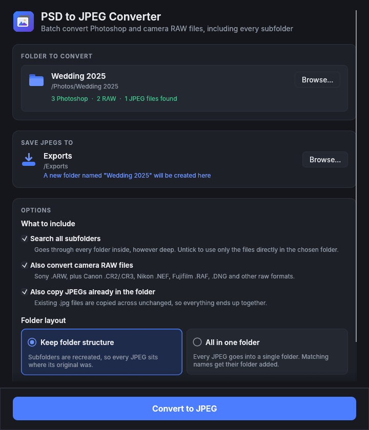

# PSD to JPEG Converter

Batch converts Photoshop files to JPEG. Point it at a folder and it converts every `.psd` and `.psb` file in that folder **and all of its subfolders, however deep**. It can also convert camera RAW files (Sony `.ARW` and others) and copy across any JPEGs already there. The JPEGs can either keep the same folder layout or all go into one folder. Your original files are never touched.



```
Choose:  D:\Photos            →  save the copy in:  E:\Exports

D:\Photos\                       E:\Exports\Photos\
├── cover.psd                    ├── cover.jpg
├── 2024\                        ├── 2024\
│   └── Holiday\beach.psd        │   └── Holiday\beach.jpg
└── Clients\poster.psb           └── Clients\poster.jpg
```

## Download

Go to the **Releases** page and download the file for your computer (ignore the two "Source code" links, which GitHub adds automatically):

| Computer | File | First launch |
|---|---|---|
| Windows | `PSD-to-JPEG-Converter-Windows.exe` | Just double-click it. If SmartScreen appears, click *More info → Run anyway*. |
| Mac (Apple Silicon or Intel) | `PSD-to-JPEG-Converter-Mac.dmg` | Open it and drag the app into *Applications*. The first time, right-click the app → *Open* → *Open*. |
| Linux | `PSD-to-JPEG-Converter-Linux.tar.gz` | Extract it and run `./psd-to-jpeg-converter`. |

## Using it

1. **Folder to convert** – click *Browse…* (or drag a folder onto the window).
2. **Save JPEGs to** – choose where the converted folder should be created. A folder with the same name as the one you're converting is made there.
3. Choose **what to include**:
   - **Search all subfolders** (on by default) – every folder inside, at every level, including folders that are shortcuts to somewhere else. Untick it to use only the files directly in the chosen folder.
   - **Also convert camera RAW files** – Sony `.ARW`, plus Canon `.CR2`/`.CR3`, Nikon `.NEF`, Fujifilm `.RAF`, `.DNG` and other raw formats. They're developed at full resolution, with brightness, contrast and colour matched to the preview the camera stores in each file, so they look like the camera's own JPEGs.
   - **Also copy JPEGs already in the folder** – existing JPEGs are copied across unchanged, keeping their names. If a camera saved `DSC001.ARW` and `DSC001.JPG` together, the camera's JPEG keeps its name and the converted one becomes `DSC001 (ARW).jpg`.
4. Pick a **folder layout**:
   - **Keep folder structure** – the subfolders are recreated, so each JPEG sits where its original was (as in the example above).
   - **All in one folder** – every JPEG goes into a single folder. If two files have the same name, the folders they came from are added to the name, e.g. `2024 - Holiday - beach.jpg`.
5. Set the **JPEG quality** (92 is a good default; 100 = largest files) and click **Convert to JPEG**.

- Files are converted several at a time, using every CPU core.
- **Stop** finishes the files in progress, then stops. With *Skip files already converted* ticked, running it again carries on where it left off, so very large batches can be done in sessions.
- Anything that couldn't be converted or needs checking, including any folder that couldn't be opened, is listed in `conversion-problems.txt` inside the output folder (the *Open problem list* button opens it).

## What it handles

- PSD and PSB (large document format) files, any size up to JPEG's limit of 65,535 pixels per side
- 8, 16 and 32-bit images; RGB, CMYK, Grayscale, Duotone, Bitmap, Indexed and Lab colour
- Photoshop files saved without an extension (common with older Mac files) are recognised too
- Transparent areas become white (JPEG has no transparency)
- macOS `._` hidden files on external drives are ignored

### Good to know

- The converter uses the flattened preview Photoshop stores inside each file, which is exactly what Photoshop shows and very fast. If a layered file was saved with **Maximize Compatibility** turned off, that preview may be missing; the converter then tries to combine the layers itself and flags the file in the problem list so you can check it. If it can't, re-save that file in Photoshop with *Maximize PSD and PSB File Compatibility* set to *Always* (Preferences → File Handling).
- CMYK and Lab files are converted to RGB with a standard formula rather than your colour profile, so colours can differ slightly from Photoshop's own export.
- The JPEGs don't carry an embedded colour profile and are treated as sRGB.

## Command line

Running the program with arguments skips the window:

```
psd-to-jpeg-converter <SOURCE FOLDER> <DESTINATION FOLDER> [--quality 92] [--raw] [--copy-jpegs] [--flatten] [--no-subfolders] [--overwrite] [--threads N]
```

`--raw` also converts camera RAW files, `--copy-jpegs` copies existing JPEGs, `--flatten` puts everything into one folder, and `--no-subfolders` uses only the files directly in SOURCE.

## Building from source

Install Rust from <https://rustup.rs>, then:

```
cargo build --release
```

The program is at `target/release/psd-to-jpeg-converter` (`.exe` on Windows). Pushing a tag such as `v1.2.0` (or running the *Build* workflow from the Actions tab with a release tag filled in) makes GitHub build and publish the Windows, Mac and Linux downloads automatically.
